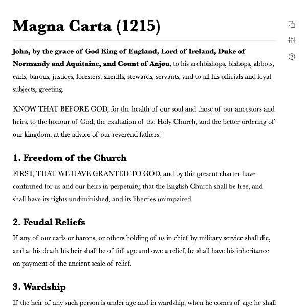

# `md`

A dead simple markdown editor. Paste it in, tweak it, and copy it back out.

  
[<kbd> haaans.com/md  </kbd>](https://haaans.com/md/)

## Features

<table>
<tr valign="middle">
<td width="50%">
<h3>One-click edit</h3>

Paste, edit and render simple markdown. Share entire docs without databases through encoded URL parameters.

</td>
<td width="50%">

</td>
</tr>
<tr valign="middle">
<td width="50%">

</td>
<td width="50%">
<h3>Just how you like it</h3>

All you got is type, so tweak fonts, spacing and vertical rhythm. Also good CSS print styles, because paper is still cool.

</td>
</tr>
</table>
