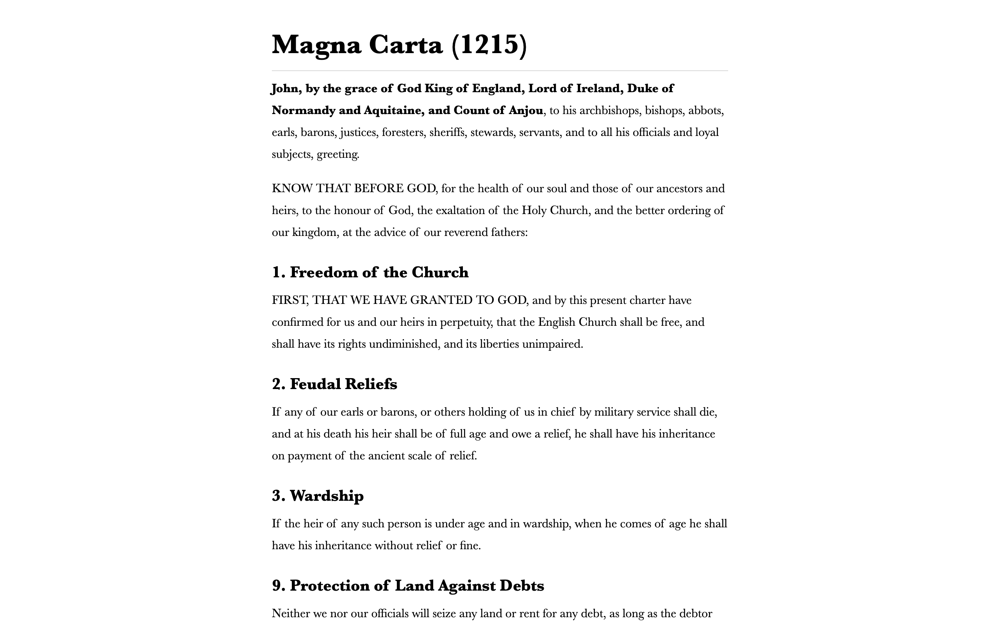
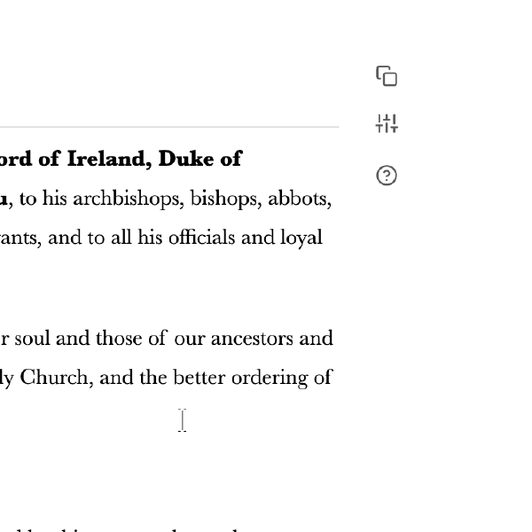

# `md`

A dead simple markdown editor. Paste it in, tweak it, and copy it back out.

  
[<kbd> haaans.com/md  </kbd>](https://haaans.com/md/)

## Features

<table>
<tr valign="middle">
<td width="50%">

Click anywhere to edit

</td>
<td width="50%">

</td>
</tr>
<tr valign="middle">
<td width="50%">

</td>
<td width="50%">

One click copies it

</td>
</tr>
<tr valign="middle">
<td width="50%">

Tune font and spacing

</td>
<td width="50%">

</td>
</tr>
</table>
